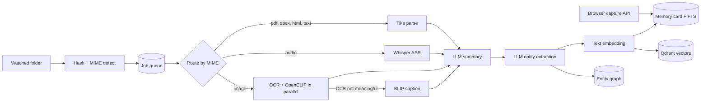
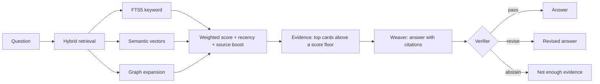

# EchoGarden

A local-first memory for everything you read, save and record. Drop files into a folder, or send highlights and bookmarks from the browser. EchoGarden extracts the text, links it into a knowledge graph and answers questions with citations to your own material. Nothing leaves your machine: parsing, embeddings and the LLM all run locally.

Built in 24h at AIMinds 2026 (1st place); the tag `aiminds-2026-submission` shows the submitted state, later commits are cleanup.

## Why

Personal notes and files pile up in places that keyword search handles badly, and cloud assistants need you to upload all of it. EchoGarden keeps the data on your machine. It answers only from what it retrieved, and says so when that isn't enough.

## How it works

### Ingestion



Every file becomes a **memory card** in SQLite with its text, summary and metadata. Its text vector goes to Qdrant, and extracted entities become graph nodes linked to the card. Each tool call is recorded as a node in an execution trace, which you can read back from `GET /exec/{trace_id}`.

### Chat



## Run it

You need Docker. Set `EG_HOST_WATCH_PATH` in `.env` to the folder you want watched.

```bash
cp .env.example .env
docker compose up --build
docker compose exec ollama ollama pull phi3:mini
```

- UI: <http://127.0.0.1:5173>
- API docs: <http://127.0.0.1:8000/docs>
- Health: `curl http://127.0.0.1:8000/healthz`

The first build is slow because it installs PyTorch and pre-downloads the embedding and caption models. Without the LLM pull everything still runs, but answers fall back to deterministic templates.

Try it without the folder watcher:

```bash
curl -X POST http://127.0.0.1:8000/ingest -H "Content-Type: application/json" \
  -d '{"text": "EchoGarden keeps vectors in Qdrant and the graph in SQLite."}'
curl -X POST http://127.0.0.1:8000/chat -H "Content-Type: application/json" \
  -d '{"message": "Where are the vectors stored?"}'
```

### Tests and lint

```bash
cd api
pip install -r requirements-dev.txt
ruff check . && ruff format --check .
pytest
```

The tests replace Ollama, Qdrant, Tika and the embedding models with fakes, so they need none of them installed. CI runs the same commands.

## Design choices

**Hybrid scoring.** Each signal is normalized to [0, 1] and combined as

```text
score = 0.45·semantic + 0.35·fts + 0.15·graph + 0.05·recency + source_boost
```

- **Semantic:** cosine similarity from all-MiniLM-L6-v2 vectors in Qdrant.
- **FTS:** SQLite FTS5 bm25, mapped through `|rank| / (1 + |rank|)`.
- **Graph:** 0.7 for cards one entity hop away from the top seeds, 0.4 for two hops.
- **Recency:** `exp(-days / 30)`.
- **Source boost:** browser highlights +0.10, bookmarks +0.05, files and audio +0.03, plain page visits −0.10.

The result is clamped to [0, 1] and anything under 0.18 is dropped. Semantic carries the most weight because questions rarely reuse the exact words of the source. FTS keeps exact names and identifiers findable. Every result explains itself: per-signal scores plus reason tags (`fts_match`, `semantic_text`, `graph_expand`).

**Graph from extracted entities.** A local LLM extracts typed entities (Person, Org, Project, Topic, Technology, …). Names are canonicalized (case, articles, punctuation, plurals) and hashed into stable node ids, so "Vector Databases" and "the vector database" land on one node. Cards link to entities with `MENTIONS` or `ABOUT` edges, capped at 30 per card. Each edge records which trace and tool call created it. Retrieval walks these edges to surface cards that share entities with the best direct matches.

**Verifier verdicts.** The weaver answers only from the evidence block, and citations that don't point at a retrieved card are discarded. The verifier then returns one of three verdicts:

- `pass` returns the answer as it is.
- `revise` replaces it with the verifier's corrected version.
- `abstain` replaces it with an explicit "not enough evidence".

Without an LLM, a heuristic stands in: no evidence means abstain, no citations means revise.

**Local-first.** All ports bind to 127.0.0.1. Models are cached under `data/models` and the API container runs Hugging Face in offline mode. The LLM is Phi-3 mini through Ollama. Every model has a `stub` mode (`EG_WHISPER_MODE`, `EG_OPENCLIP_MODE`) for development without downloads.

## Project layout

```text
api/app/
  orchestrator/   pipelines for ingest and chat, MIME routing, exec traces
  agents/         registry adapters: each tool behind one envelope/result contract
  tools/          model and service clients (Tika, Whisper, OCR, embeddings, Qdrant)
  retrieval/      hybrid scoring and graph expansion
  graph/          entity graph storage and name canonicalization
  llm/            Ollama client and prompts
  capture/        folder watcher, hashing, job queue
  routers/        HTTP endpoints
  db/             SQLite schema, migrations, queries
ui/               React + Vite front end, served by nginx
docs/             development notes from the hackathon
```

Settings are read in one place, `api/app/core/config.py`, and every variable is listed in `.env.example`. The `/debug` inspection endpoints expose raw tables without auth, so they only load with `EG_DEBUG=true`.

## Known limitations

- The verifier fails open. Output it can't parse, or a verdict it doesn't know, counts as `pass`. The no-LLM heuristic only checks that citations exist, not that they support the answer.
- The weaver and verifier logic exists twice, in `agents/` and in `orchestrator/llm.py`. Which copy runs depends on whether Ollama is reachable.
- FTS indexes card summaries, not full text.
- SQLite calls are synchronous inside async handlers, and each query opens a new connection. Fine for one user, not for many.
- Schema changes are idempotent scripts run at startup, with no migration versions.
- Each chat turn is stored twice: in `conversation_turn` with the raw answer, and in `conversation_turn_v2` for the UI threads.
- Only the browser capture endpoints are authenticated. Python dependencies are unpinned, and the Qdrant and Ollama images use `latest`.
- Phi-3 mini on CPU is slow, and its JSON output is not always valid.

## Next steps

- Make the verifier fail closed, and check that each cited quote appears in its evidence.
- Keep one weaver and verifier implementation.
- Index full text in FTS, and tune the weights on a small labelled query set instead of by hand.
- Move to async SQLite access and versioned migrations.
- Pin dependencies and image tags.
